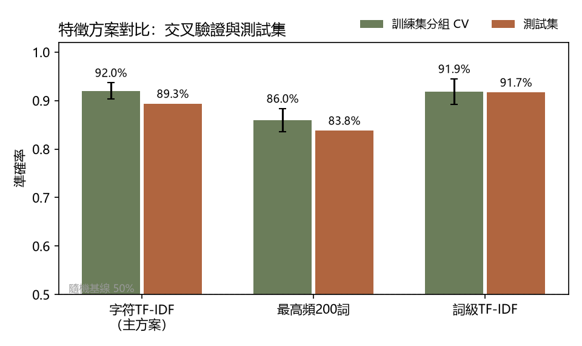
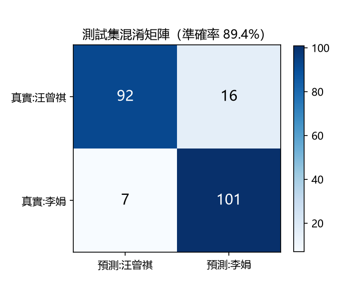
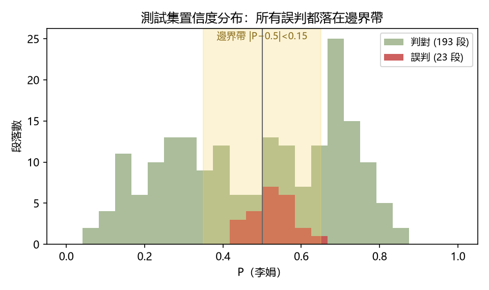
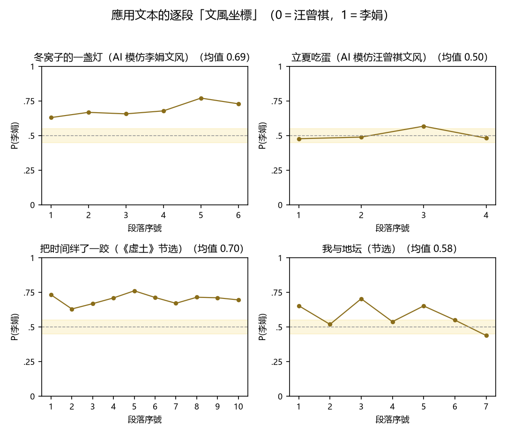
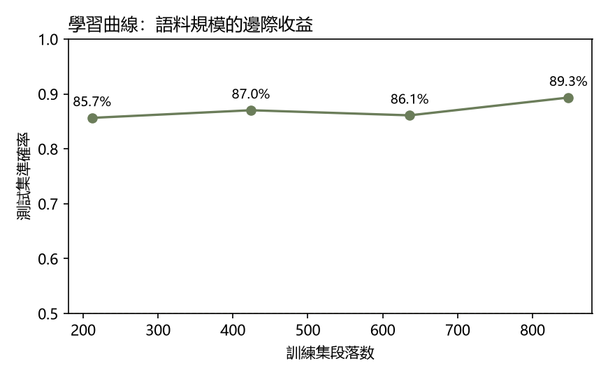

# 能憑統計指紋分開「同一譜系」的散文嗎？——以邏輯迴歸區分汪曾祺與李娟

## 一、引言

之所以比較汪曾祺和李娟，是因爲二人常被放在「閒話體」散文脈絡中討論。他們以平視、溫和的語調，從日常裡挖掘詩意與哲思，也都用近乎口語的白描在平淡中見奇趣。李娟甚至被稱為「汪曾祺的傳人」。這類判斷依賴讀者直覺，也可以操作化：把「這段文字出自誰手」變成二元分類任務，讓機器只憑表層特徵作答，再檢驗印象。兩位作家題材高度重疊，分類器必須捕捉更細的東西——虛詞習慣、句子節奏與標點偏好。本文用一千餘個自然段訓練邏輯迴歸分類器，追問模型究竟在看什麼。

## 二、標籤定義與資料

標籤以版本出處為準：段落出自哪位作家的正式出版作品，即標註對應標籤，避免「讀起來像誰」的主觀判斷。文本單位選用自然段（長度 30–600 字，超長片段在句末切為 500 字以內），每篇最多取 40 段。段落是能感知完整風格的最小單位：整篇文章樣本量不足，單句則會丟失語氣與節奏。

汪曾祺語料取自 GitHub 公開的《汪曾祺全集》OCR 文字版散文卷，共 196 篇；李娟語料取自官方公開轉載的散文篇目，人工剔除作者簡介、相關報導等非原文內容。清洗時統一標點全半形，並去除亂碼、低中文占比段落及重複文本。每篇最多保留 40 段後，汪曾祺有 2,810 段、李娟有 532 段；平衡後每類 532 段，共 1,064 段，訓練集 848 段、測試集 216 段。

## 三、切分與特徵

切分是容易出錯的環節。我們按作品而非段落以 80/20 切分，同篇段落只會進入訓練集或測試集其中一邊。同篇文字彼此相似，若隨機分散，評估就會偏樂觀。對照實驗印證了這點：按段隨機切分準確率為 95.3%，按篇切分為 89.3%。

特徵選擇只用訓練集：三種方案先做五折交叉驗證，且按作品分組。普通交叉驗證因同篇段落跨折而報出 93.1%，分組後為 92.0%。字元級 TF-IDF 的分組 CV 為 92.0%±1.7%，詞級 TF-IDF 為 91.9%±2.6%；因此依分組 CV 選字元方案，沒有根據測試集分數改選模型。雖然詞級方案在本次測試集分數較高，但兩者差異不顯著（見 McNemar 檢驗）。TF-IDF 會降低「的」「了」等常見詞的權重；字元二元組無需分詞器，也能捕捉「俺們」「了罷」等搭配。模型把特徵加權求和，再經 S 形函數轉為 P(李娟)；訓練就是調整權重，使預測貼近標籤。

| 特徵方案 | 訓練集分組交叉驗證 | 測試集 |
|---|---|---|
| 字元 1–2 元 TF-IDF（主方案） | 92.0% ± 1.7 | 89.3% |
| 最高頻 200 詞詞頻 | 86.0% ± 2.4 | 83.8% |
| 詞級 TF-IDF（jieba） | 91.9% ± 2.6 | 91.7% |

## 四、測試集結果

在 216 段測試集中，準確率為 89.3%（均衡隨機基線 50%）。混淆矩陣顯示：汪曾祺 108 段中 92 段判對、16 段誤判為李娟；李娟 108 段中 101 段判對、7 段誤判為汪曾祺。汪曾祺精確率 0.929、召回率 0.852；李娟分別為 0.863、0.935。按篇內多數投票後，41 篇測試文章的準確率升至 92.7%。單段風格模糊時容易誤判，整篇投票則能平滑部分邊界段落。

為檢查結果穩定性，我按作品、在作者內分層做一萬次群集自助抽樣，平衡準確率的 95% 置信區間為 82.3%–94.8%；五個隨機種子的準確率為 89.4%–97.1%（均值 92.5%），本文報告最保守的一次。字元級與詞級 TF-IDF 的差異不顯著（McNemar 檢驗 p=0.42）。

錯誤並不對稱：模型「認出」李娟的能力（召回率 93.5%）強於汪曾祺（85.2%）。李娟文風更統一，汪曾祺語料跨近五十年、含談藝文字，內部差異性更大，因此有更多段落被識別為李娟所寫。

## 五、錯誤分析

全部 23 個誤判有一處驚人的共性：置信度都落在 |P−0.5|<0.15 的邊界帶內（圖三）——模型沒有一次「自信地犯錯」。這說明它真正難住的，不是隨機噪音，而是兩位作家風格交疊最明顯的那塊空間。

按篇彙總看清走向。汪曾祺一側的錯誤集中於最具「白描」風格的遊記與生活篇目：〈滇遊新記〉4 段、〈冬天〉3 段、〈夏天的昆蟲〉與〈新校舍〉各 2 段。例如〈冬天〉一段被以 0.62 的機率判給李娟——口語短句、生活小物、不著一句抒情，與李娟的白描確實相似，人類讀者恐怕也要猶豫。另外一個有意思的誤判是《滇遊新記》，這篇文章明明充斥著滇南色彩，多次出現雲南地名、風物與習俗，卻被誤認爲是李娟所寫。但這説明在字符級特徵的權重體系裡，通篇的語氣、節奏、視角，遠比零星幾個地域專名分量重得多。這也和之後所做的「遮蔽專名實驗」形成了呼應。但李娟一側的最大來源是《記一忘三二》代自序（5 段）—— 她談閱讀與寫作的文字，題材恰好伸進汪曾祺談藝文的領地。兩個方向指向同一結論：寫「生活」時兩人像，寫「文學」時也像 —— 誤判本身就是譜系親緣的定量證據。

## 六、應用到訓練資料之外

把模型用於訓練資料之外的文字，逐段輸出「屬於李娟」的機率並對全篇取平均：史鐵生《我與地壇》節選 0.580，劉亮程〈把時間絆了一跤〉0.702。另有兩組 AI 探測文字（按兩位作家的語言習慣生成，試驗設計在此如實宣告）—— 模仿李娟者得 0.690，透過「測謊」；模仿汪曾祺者 0.505，恰好壓線。

對這組讀數需要注意三個方面。其一，四篇文本的分數約在 0.50–0.71：模型面對分佈外文字會猶豫，分數只代表相對於兩位作家的傾向。其二，「更像誰」不等於「是誰」——劉亮程讀數最高，可能與他同樣書寫新疆荒野有關。其三，AI 模仿李娟者複製了模型權重較大的表層特徵（省略號、破折號、「我媽」「外婆」），得分 0.690；模仿汪曾祺者為 0.505，接近邊界。作為讀者，我能看出兩篇都不是原作手筆，正所謂「形似神不似」。AI 模仿抓住外顯風格，卻放大題材差異、忽略兩人文風的重合處：李娟模仿文大量使用新疆荒野元素，汪曾祺模仿文則聚焦四季風物和江南吃食。這說明模型捕捉到的部分特徵易被刻板印象式地複製，並非更深層的文學氣質。

| 應用文字 | 平均 P(李娟) | 多數預測 |
|---|---|---|
| 史鐵生《我與地壇》節選 | 0.580 | 偏李娟 |
| 劉亮程〈把時間絆了一跤〉 | 0.702 | 偏李娟 |
| AI 模仿汪曾祺文風（自制） | 0.505 | 恰在邊界 |
| AI 模仿李娟文風（自制） | 0.690 | 偏李娟 |

## 七、穩健性檢驗與限制

AI 模仿實驗也引出一個問題：模型依賴文體指紋，還是題材詞？遮蔽人名、地名等專名後，準確率為 88.9%，與基線 89.3% 接近；只用約 120 個虛詞做 z-score，準確率仍有 75.0%。這說明模型不只看題材，語言習慣本身也提供了訊號；但題材詞仍可能是容易模仿的表層線索。

學習曲線（圖五）顯示，訓練語料從四分之一增到全量，準確率僅由 85.7% 升至 89.3%：規模的邊際收益存在但有限，曲線也未完全飽和——這為擴充李娟語料（如《羊道》三部曲）提供了直接依據。

限制也需指出：紙書 OCR 與網頁轉載的語料管道不同，錯字可能成為模型線索；李娟可用作品較少，同集篇章共享詞彙，按篇切分仍不能完全排除書內洩漏；段落結果也不能直接推廣到整本書。後續可加入第三位作家，並用逐段特徵歸因檢視預測依據。

## 八、結語

這個小分類器沒有推翻「李娟承接汪曾祺」的文學史直覺；恰恰相反，它把直覺變成可以測量、可以出錯、也可以複核的物件 —— 相似的是題材與姿態，可分的是句子層面的統計指紋，正是親緣最誠實的定量形態。對「用機器讀文學」的合理態度由此而來：模型能分辨的，是最基本的語言指紋，是作者下筆時不自覺的語言習慣。但那些誤判的例子，分不開的邊界，才是文學的真實態度。當邊界模糊的時候，正是作者們思想靠近、内核相似之時。模型可以為文學研究提供測量與定位，但文字背後的溫度與重量，依然需要回歸人的閲讀。

## 資料來源註記

汪曾祺文本取自 [fancyerii/wang](https://github.com/fancyerii/wang) 的《汪曾祺全集》文字版；李娟篇目與應用文本的來源 URL 記錄於 `data/raw/` 的 manifest 清單及各文本檔案註記中。原作版權歸作者及權利人所有。